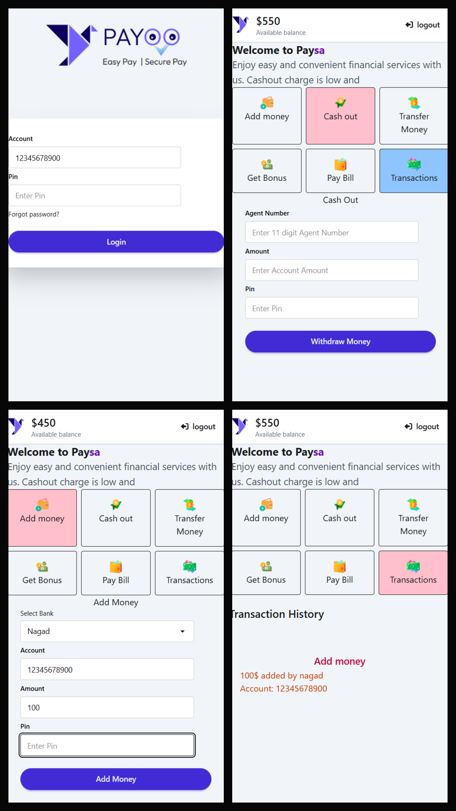

# 💸 PaySa – Mobile Banking Dashboard

A simple, responsive mobile-banking web app UI built with **HTML, Tailwind CSS, DaisyUI, and Vanilla JavaScript**. Log in, add money, cash out, and view your transaction history, all in the browser.

---

## 🚀 Features

- 🔐 **Login system** – 11-digit account number + PIN validation
- 🏠 **Dashboard** – balance display, welcome banner, and a service grid
- ➕ **Add Money** – choose a bank (Bkash / Nagad / Upay), enter account, amount, and PIN
- 💵 **Cash Out** – withdraw money to an agent number with balance checking
- 📜 **Transaction History** – every add-money and cash-out is logged
- 🚪 **Logout** – returns to the login page
- 💳 **Animated card** – a 3D hover bank-card design
- 📱 **Responsive** – mobile-first layout (`max-w-md` / `lg:max-w-lg`)

---

## 🛠️ Tech Stack

| Technology | Purpose |
|---|---|
| 🧱 HTML5 | Structure |
| 🎨 Tailwind CSS v4 (CDN) | Styling |
| 🌼 DaisyUI v5 (CDN) | UI components |
| ⭐ Font Awesome 7 | Icons |
| ⚙️ Vanilla JavaScript | Logic and interactivity |

---

## 📁 Project Structure

```
PaySa/
├── 📄 index.html            # Login page
├── 📄 main.html             # Dashboard page
├── 📂 assets/
│   ├── logo.png
│   ├── Logo-full.png
│   └── opt-1.png ... opt-6.png
├── 📂 script/
│   ├── login.js             # Login validation
│   ├── logout.js            # Logout redirect
│   ├── addmoney.js          # Add money logic
│   ├── cashout.js           # Cash out logic
│   ├── toggle.js            # Section show/hide
│   └── transaction.js       # Transaction tab events
├── 📂 utilities/
│   └── utilities.js         # Reusable helper functions
└── 📄 tailwind.config.js
```

---

## 🔑 Demo Credentials

| Field | Value |
|---|---|
| 👤 Account Number | `12345678900` (any 11 digits) |
| 🔢 PIN | `1234` |

---

## ▶️ How to Run

1. 📥 Clone or download the project
   ```bash
   git clone https://github.com/your-username/paysa.git
   ```
2. 📂 Open the project folder
3. 🌐 Open `index.html` in your browser (or use VS Code **Live Server**)
4. 🔐 Log in with the demo credentials above
5. 🎉 Start using the dashboard!

---

## 🧠 How It Works

### 🔐 Login (`login.js`)
- Checks that the account number is exactly **11 digits**
- Checks that the PIN equals **1234**
- Redirects to `main.html` on success

### ➕ Add Money (`addmoney.js`)
- Validates amount, PIN, and account number
- Rejects negative amounts
- Adds the amount to the balance and logs the transaction

### 💵 Cash Out (`cashout.js`)
- Validates the agent number (11 digits) and PIN
- Prevents withdrawing more than the available balance
- Deducts the amount and logs the transaction

### 🔄 Toggle (`toggle.js`)
- Shows only one section at a time (Add Money / Cash Out / Transactions)
- Highlights the active service box in pink

### 🧰 Utilities (`utilities.js`)

| Function | Description |
|---|---|
| `getValueById(id)` | Returns an input's value |
| `getConvertedTextById(id)` | Returns an element's text as a number |
| `getConvertedValueById(id)` | Returns an input's value as a number |
| `displayStatus(id, status)` | Shows or hides an element |
| `boxColor(id, color)` | Changes an element's background color |

---

## ⚠️ Known Issues / Future Improvements

- 🐛 `type="pin"` is not a valid input type; use `type="password"` instead
- 🔒 PIN is hard-coded; a real backend is needed for production use
- 💾 Balance and transactions reset on refresh; consider `localStorage`
- 🧾 "Transfer Money", "Get Bonus", and "Pay Bill" are not implemented yet
- 🎨 Add a transaction timestamp and a clear-history button

---

## 📸 Screenshots


---

## 🙌 Acknowledgements

- 🌼 [DaisyUI](https://daisyui.com/)
- 🎨 [Tailwind CSS](https://tailwindcss.com/)
- ⭐ [Font Awesome](https://fontawesome.com/)

---

## 👨‍💻 Author

**Your Name**
- 🌐 GitHub: [ISeyamin](https://github.com/iseyamin)
- 📧 Email: iseyamin@gmail.com

---

⭐ If you like this project, give it a star! ⭐
